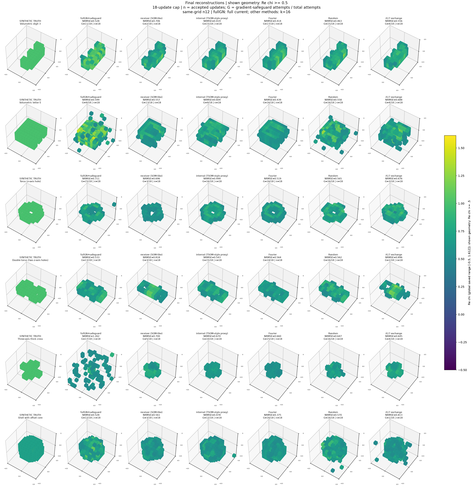
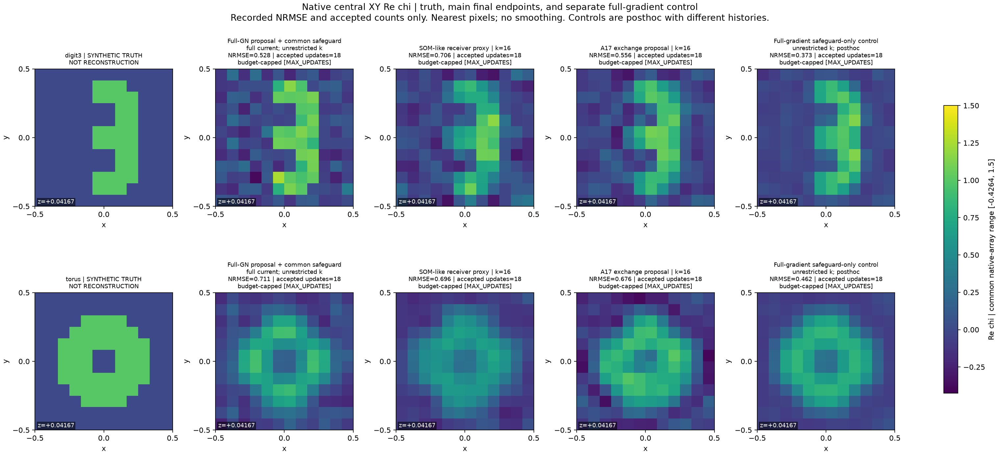

# 六类三维目标的最终材料重建：A17与五种对照

**结论：这组实验不支持A17具有普遍的最终成像优势。** 在固定的六个目标上，A17的复材料NRMSE有3/6低于receiver；对象比值A17/receiver的中位数为1.0328，即中位误差约增加3.28%。普通完整梯度在两个固定追加对照上都取得更低材料误差。

这并不否定原论文关于Maxwell电流改动如何影响局部材料更新的机制。它明确限制了应用结论：局部全GN步保真度提高，尚不能当作更好的最终材料图像。**我不建议用这组结果把论文改写成普遍优越的成像算法。**

36条主轨迹与2条梯度控制均完成18次接受更新，终态全部为MAX_UPDATES。它表示到达迭代上限，不表示已收敛。累计受控计算8700.104秒（2小时25分钟），包括适配核验、合成、失败及接续；没有追加训练或新目标。

## 1. 先看最终误差

主要指标为最后接受材料的复NRMSE，越低越好。粗体仅表示该行六种主方法中最低值；不是统计显著性或收敛认证。

| 目标 | 完整GN提案* | Receiver / SOM-like | 内部传播proxy | Fourier | 随机空间 | A17交换 |
|---|---|---|---|---|---|---|
| 立体数字3 | 52.82% | 70.59% | 41.92% | **41.38%** | 46.33% | 55.58% |
| 字母E | 59.93% | 55.67% | 60.44% | **43.87%** | 55.78% | 68.85% |
| 单环 | 71.06% | 69.61% | **49.89%** | 51.94% | 56.51% | 67.60% |
| 双环 | **53.33%** | 81.83% | 54.29% | 56.44% | 56.17% | 89.57% |
| 三轴交叉杆 | 126.23% | 69.99% | 67.02% | 66.00% | 64.70% | **64.46%** |
| 偏心核壳 | 52.76% | 56.06% | 47.82% | **37.53%** | 57.00% | 81.34% |

*完整GN列准确含义是“完整GN提案＋共同约束投影／梯度保护／线搜索”，不是一个已充分收敛的最佳GN求解器。五种电流ROM的终点秩均按k=16构造；完整GN不受该秩约束。SOM-like与内部传播proxy也不是原生SOM/TSOM完整优化器。

第一列标为SYNTHETIC TRUTH；后六列才是各方法的重建。图中只显示Reχ≥0.5的体素，它会隐藏弱背景误差。完整对照还应看[原始实部切片](figures/RAW_REAL_XY_central.png)和[原始虚部切片](figures/RAW_IMAG_XY_central.png)。这些图没有平滑，也没有用真值修补重建。

## 2. 这次重建的是什么

六个对象是立体数字3、字母E、单环、双环、三轴交叉杆，以及带偏心内核的空腔壳体。前五种主体χ=1+0.08i；壳与核分别为0.7+0.06i和1.4+0.12i，背景为0。形状在合成数据前固定，算法不知道支撑、边界和孔洞。

使用原三维矢量Maxwell DDA。十二次入射（±三轴、各两横向偏振）共享同一复材料；64个双偏振接收位置提供观测，另80个旋转接收位置只做离线评价。每对象一个固定的1%复噪声实现。所有方法从χ=0.1+0.01i的均匀初值开始，没有N3或其他学习先验。

12³网格含1728个复材料未知量，即3456个实未知量。电流有三个矢量分量；k=16只限制切向电流表示，**不是只重建16个材料参数**。完整forward和共同梯度仍使用完整物理。

各方法共享prior定义、LM schedule、被动性约束、可行投影与Armijo线搜索，只改变电流/GN更新提案。详细方法与指标解释见[METHODS_AND_INTERPRETATION_ZH.md](METHODS_AND_INTERPRETATION_ZH.md)。

## 3. 哪些地方确实改善，哪些地方没有

| 目标 | A17 / receiver | A17材料误差相对下降（负值为恶化） |
|---|---|---|
| 立体数字3 | 0.7873 | +21.27% |
| 字母E | 1.2367 | -23.67% |
| 单环 | 0.9710 | +2.90% |
| 双环 | 1.0945 | -9.45% |
| 三轴交叉杆 | 0.9209 | +7.91% |
| 偏心核壳 | 1.4510 | -45.10% |

数字3有清楚的receiver相对收益，但内部传播proxy、Fourier、随机空间和完整GN都得到更低的最终材料误差。字母E上，A17反而弱于全部五种主对照。单环的receiver相对收益较小；双环和偏心核壳出现恶化。三轴交叉杆是A17在六种主方法中数值最低的一例，但它与随机空间非常接近，不能把这一细小差距当成稳健优势。

**负面判断并非完全依赖GPU阶段。** 数字3和字母E的十二条主轨迹均在最早的Mac CPU阶段结束，已经呈现“A17对receiver有时有增量，但没有全面胜过更强对照”。后续运行异常不能解释掉这部分证据。

字母E还有一个值得注意的现象：完整GN测量残差约8.71%，Fourier约13.87%；材料NRMSE却分别约59.93%和43.87%。测量拟合更好与材料真值误差更小不是同一件事。

## 4. 为什么必须加入普通梯度控制

原共同外层会在投影后的提案不下降时切换到完整材料梯度，再做相同线搜索。这个保护分支有时占据了大部分更新：

| 目标 | 完整GN提案* | Receiver / SOM-like | 内部传播proxy | Fourier | 随机空间 | A17交换 |
|---|---|---|---|---|---|---|
| 立体数字3 | 11/18 | 2/18 | 15/18 | 17/18 | 15/18 | 4/18 |
| 字母E | 9/18 | 13/18 | 9/18 | 16/18 | 16/18 | 4/18 |
| 单环 | 15/18 | 3/18 | 16/18 | 16/18 | 16/18 | 3/18 |
| 双环 | 13/18 | 3/18 | 15/18 | 14/18 | 16/18 | 1/18 |
| 三轴交叉杆 | 17/18 | 5/18 | 10/18 | 15/18 | 16/18 | 4/18 |
| 偏心核壳 | 12/18 | 3/18 | 12/18 | 16/18 | 16/18 | 1/18 |

因此，Fourier或随机空间形成的好图像，不能全部归功于相应电流基底。完整GN在交叉杆上也有17/18次梯度回退，其差结果不能代表所有约束GN算法。

我在发现这个现象后，固定追加数字3和单环的普通完整梯度控制；它使用原来就存在的保护方向，不构建电流ROM或完整Jacobian。这个对照是post-hoc归因诊断，不能把不同历史轨迹当成唯一组件的因果证明。

| 目标 | Receiver NRMSE | A17 NRMSE | 普通完整梯度 NRMSE | 梯度控制分解准入 | 梯度控制RHS |
|---|---|---|---|---|---|
| 立体数字3 | 70.59% | 55.58% | 37.32% | 86 | 1248 |
| 单环 | 69.61% | 67.60% | 46.24% | 86 | 1248 |

普通梯度的最终材料误差在这两个对象上都更低。不过，它各需要86次full分解准入，不能只因RHS较少便称总成本更低；后端也不同。本组没有建立相同总wall下的优越性。

## 5. 外形接近，不等于复材料接近

| 目标 | A17实部NRMSE | A17虚部NRMSE | A17支撑IoU | A17测量残差 | A17留出误差 |
|---|---|---|---|---|---|
| 立体数字3 | 51.99% | 251.86% | 0.9504 | 23.77% | 25.61% |
| 字母E | 64.84% | 297.39% | 0.6710 | 26.97% | 30.16% |
| 单环 | 62.49% | 329.12% | 0.8571 | 37.06% | 38.81% |
| 双环 | 83.96% | 399.94% | 0.5048 | 51.53% | 54.12% |
| 三轴交叉杆 | 61.15% | 262.97% | 0.7000 | 27.46% | 29.60% |
| 偏心核壳 | 71.69% | 455.74% | 0.5592 | 39.47% | 42.14% |

所有A17终点的虚部相对误差都很大。举例，数字3的支撑IoU约0.95，但复材料误差仍约55.6%，损耗分量误差约252%。只看Reχ≥0.5的三维图，会高估材料恢复质量。

偏心核壳的真实内核仅占8个网格点。原始切片显示，外部轮廓与内部高对比小核的恢复是两个不同问题；即使Fourier的全局NRMSE最低，也不能由此宣称小核幅值被准确恢复。A17该例有明显背景伪影、位置和幅值失真。

我逐图看过全部六种目标的三维终态与原始实部切片，并检查了虚部和另外的原生切面。这里没有“几乎完美重建”的依据。

## 6. 这对A17论文意味着什么

原论文问的是：给定当前材料状态和残差，替换一个电流方向，什么时候能改善这一刻的完整材料二次模型？其入口是J=SL⁻¹B，并通过材料注入、保留电流反馈和接收返回追踪具体空间改动的后果。

本实验执行的最终更新还经过材料约束和线搜索。A17核验的端点步差是d=s_new−s_receiver；真正执行的是αΠχ(s_new)。之后还要继续改变材料状态、总场和残差。因此，冻结二次模型中的正收益不提供最终真值误差的排序保证。新结果展示了这个边界，而不是推翻已有代数恒等式。

我的判断是：**机制和局部表示设计仍是论文应该保留的主线；一般性成像优越性没有建立。** 这批图可以作为补充应用和限制说明，不宜挑出交叉杆或数字3单独作为“全面优于GN/SOM”的主证据。

## 7. 时间、运行异常与证据强度

工作先在Mac CPU运行，后按用户要求迁移到i9-14900HX和RTX4060。远端CPU数值库4线程，进程调度范围限定为已识别的P-core；完整求解和批量端点使用CUDA FP64。并非全流程所有算子均在GPU，基底构造、部分材料代数和日志仍在CPU。

一次原生access violation和一次日志命名空间异常均已保留。相关轨迹从最后接受检查点在新进程接续，未重复已接受更新，也未改选择规则。**日志异常的根因和完整数值影响范围尚未确认，不能称为“已证明仅影响日志”。** 新GPU结果应连同这一限制使用，不替换原A17冻结主统计证据。

真值与反演均为12³同网格；仅一个噪声实现；全部方法达到18次上限而非共同收敛；硬件和执行版本在中途迁移。这里是有完整记录的受控应用探索，尚非独立连续模型认证、噪声鲁棒性总体试验或公平端到端性能基准。

完整费用、失败原产物与来源说明见[COST_AND_FAILURES.md](COST_AND_FAILURES.md)，重画和源码入口见[REPRODUCTION.md](REPRODUCTION.md)。旧论文及历史记录未被覆盖。
